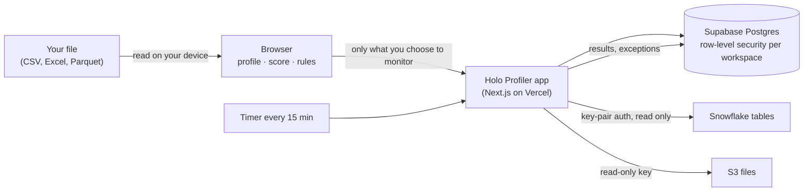

<p align="center">
  
</p>

<h3 align="center">Drop a file. See its data quality in seconds.</h3>

<p align="center">
  Holo Profiler profiles your data in the browser, suggests the rules it should pass, and keeps watching it on a schedule,<br>
  all behind a holographic interface you can orbit, pinch and zoom.
</p>

<p align="center">
  <a href="https://github.com/uchejerla/holo-profiler/actions/workflows/ci.yml"></a>
  
  
  
  
</p>

<p align="center">
  <a href="#quick-start">Quick start</a> ·
  <a href="#features">Features</a> ·
  <a href="#how-it-works">How it works</a> ·
  <a href="#security-and-privacy">Security</a> ·
  <a href="#roadmap">Roadmap</a> ·
  <a href="docs/DEVELOPMENT.md">Developer guide</a>
</p>

---

## Why Holo Profiler

Most data quality work starts the same way: someone receives a file, opens it in a spreadsheet, scrolls, and guesses. Real tools exist, but they mean a platform rollout, a warehouse connection, and weeks before anyone sees a number.

Holo Profiler collapses that to one gesture. Drop a CSV, Excel or Parquet file and you get:

- **A score you can defend:** completeness, validity, uniqueness and consistency, rolled into one file score with the reasons behind it.
- **Rules written for you:** suggested from what the data actually looks like, then edited, accepted or rejected by you.
- **A way to keep watching:** schedule those rules against a Snowflake table or an S3 folder, and work the exceptions they raise.

And the file never leaves your machine. Profiling runs entirely in the browser.

## Features

| | |
| --- | --- |
| **In-browser profiling** | CSV, TSV, Excel (.xlsx, .xls) and Parquet. Type inference, null tokens, patterns, outliers and per-column issues. Files are read on your device and are never uploaded. Up to 200,000 rows are profiled in full, with sampling beyond that. |
| **One honest score** | A file score from four weighted dimensions (completeness 35%, validity 30%, uniqueness 20%, consistency 15%) blended with the share of fully clean rows, minus a penalty for each critical issue. Good is 90+, Fair is 75+. |
| **Suggested and custom rules** | Six rule types: not null, unique (single or multi-column), range, allowed values, format (email, phone, ZIP, US state, date, UUID, URL or your own regex) and column-to-column comparisons, each with a severity. The bundled claims sample gets 37 suggestions on first drop. |
| **Snowflake-ready SQL** | Export any rule set as Snowflake SQL, or as a scheduled Snowflake `TASK` that writes results to a table. Rule sets also import and export as JSON. |
| **Holo space** | Every record becomes a point in a 3D field you orbit, pinch, zoom and throw panels around in. Blanks sit on their own plane, so gaps jump out. |
| **Wide files** | Hundreds of columns fold into a ring of related groups. Zoom into a group to split it into its columns. Tested on a 250-column file. |
| **Scheduling** | Hourly, daily or weekly runs in your own time zone. Datasets connected to Snowflake or S3 run on the server even when nobody has the page open. |
| **Monitoring and dashboard** | Run history, score trends and schema changes per dataset, with one dashboard across everything you watch. |
| **Exception management** | Each failing rule becomes one exception, not one per run. Assign an owner, add notes, resolve or waive it (a waiver needs a reason), and it reopens by itself if the rule fails again. Every status change lands in an audit log. |
| **Teams by workspace** | Magic-link sign-in, a workspace per team, and owner, admin, member and viewer roles enforced in the database. |

## How it works



The same profiling and rules engine runs in the browser and on the server, so a scheduled run scores your Snowflake table exactly the way the page scored your file.

## Quick start

**Try it without setting anything up.** Build the single-file version and open it in a browser. It runs on its own and keeps history in that browser:

```bash
git clone https://github.com/uchejerla/holo-profiler && cd holo-profiler
npm install
npm run hud          # writes dist/holo-profiler.html
```

**Run the full app locally** with sign-in, a database and the scheduler (needs Docker and the Supabase CLI):

```bash
supabase start && supabase db reset
cp .env.example .env.local    # fill in from `supabase status` and `npm run gen:secrets`
npm run dev                   # http://localhost:3000
```

The [developer guide](docs/DEVELOPMENT.md) has the details, and [DEPLOY-CHECKLIST.md](DEPLOY-CHECKLIST.md) takes you from zero to a hosted app on Vercel and Supabase.

## Built with

- **Front end:** the holographic HUD in plain JavaScript and Canvas, with no framework, served by Next.js 15 (App Router)
- **Back end:** Next.js route handlers on Vercel
- **Data:** Supabase (Postgres, row-level security, magic-link auth, pg_cron)
- **Sources:** Snowflake (key-pair auth) and Amazon S3 or S3-compatible storage
- **Tests:** Node's test runner, jsdom for the page, and a real Postgres for the security rules, run on every push

## Security and privacy

- **Your files stay with you.** Dropped files are profiled in the browser and never sent to the server. Only the results you choose to monitor are saved.
- **Workspaces are walled off in the database.** Row-level security means one workspace can't read another's data, even through the API.
- **Credentials are encrypted.** Snowflake keys and S3 secrets are encrypted with AES-256-GCM before they are stored, live in a table only the server can read, and are never sent back to the browser.
- **Least privilege by default.** Snowflake connects as a key-pair service user with read access, and S3 with a read-only key. The guides include the exact grants and policies.

Found a security issue? Please contact the maintainer through GitHub rather than opening a public issue.

## Roadmap

Ideas being considered, not promises:

- Team invites and a workspace switcher in the app
- Letting accepted rules count toward the file score, with the impact of each rule shown
- Re-encrypting saved credentials automatically when the encryption key is rotated
- More data sources beyond Snowflake and S3

## Status

Early release. The full test suite passes on every push, and the first hosted deployment is under way.

## Contributing

Ideas and bug reports are welcome as GitHub issues. For code changes, open an issue first so we can agree on the approach, then send a pull request with tests. `npm test` and `npm run build` must pass.

## License

No license has been chosen yet. Until one is added, all rights are reserved by the author.
